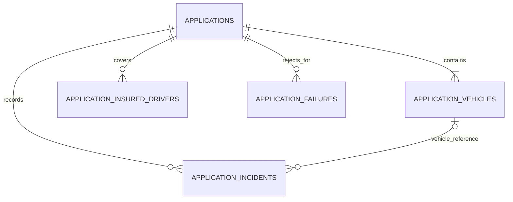

# Architecture and persistence

The service evaluates driver applications and stores an immutable snapshot of each submission and its result. PostgreSQL is the API's source of truth. The CLI uses an independent in-memory pool and shares the same parser and validation rules.

## Components

| Component | Responsibility |
| --- | --- |
| `Registration.Entity`, `Registration.IncidentFactory` | Domain objects, builders, and incident types shared by both entry points. |
| `Registration.IO.ProspectiveDriverFileParser` | Strict JSON structure, type, date, and reference checks before business evaluation. |
| `Registration.Validation` | Six eligibility strategies and a report containing their failure reasons. |
| `ApplicationController` | HTTP routing, response status, and the created resource's `Location`. |
| `ApplicationService` | Parse, evaluate, construct a snapshot, and persist it within a transaction; retrieve and page through saved applications. |
| `ApplicationRepository` | Spring Data JPA persistence and status-filtered queries. |
| `StoredApplication` | JPA aggregate, separate from mutable domain objects. There is no public update endpoint. |
| `ApplicationResponse`, `ApplicationSnapshot` | Response records assembled inside the transaction; JPA entities are not serialized directly. |
| `ApiErrorHandler` | Consistent errors without SQL details or stack traces in responses. |
| `Registration.Pool.DriverPool` | CLI-only grouping of accepted applications and last-name queries. |

The HTTP boundary accepts a `JsonNode` so the API and file importer can use one strict parser, including supported import aliases. This avoids independent binding rules at each entry point. Submitted data is stored in relational columns, not as one JSON document. See [the input contract](input-contract.md).

## Data model

| Table | Contents and constraints |
| --- | --- |
| `applications` | UUID primary key, unique request key, `APPROVED` or `REJECTED` status, audit timestamps, evaluation date, rule version, and submitted driver, license, and insurance policy fields. |
| `application_vehicles` | Ordered vehicle snapshots; unique `(application_id, plate)`. |
| `application_insured_drivers` | Ordered names listed on the submitted policy. |
| `application_incidents` | Ordered incident details with `DRIVER` or `VEHICLE` scope. Vehicle incidents include a plate and offender name. |
| `application_failures` | Ordered failure reasons returned by the validator. Approved applications have no failure rows. |

Driver, license, and policy fields share the application lifecycle and remain on the parent row. The four child tables map to JPA `@ElementCollection` values, each with `(application_id, position)` as its primary key and a cascading foreign key to `applications`.

A vehicle incident's `(application_id, plate)` foreign key references a vehicle within the same application. It is checked at commit because Hibernate does not guarantee insertion order across separate collections. Driver incidents have no vehicle reference. The application parser requires at least one vehicle and validates all incident references before persistence.

There is no global driver table or name-based identity constraint. Reapplying with a new request key creates a separate snapshot; it does not update previous applications. Retrieving a record returns its stored result without reevaluating it.

The schema provides these indexes:

- A unique index for the request key.
- `(submitted_at DESC, id DESC)` for the default list order.
- `(status, submitted_at DESC, id DESC)` for filtered lists.
- Child-table primary keys beginning with `application_id` for collection retrieval.

Collection loading may issue additional queries per page. The implementation avoids joining all collections into a Cartesian product; it does not claim large-scale query optimization.

## Transaction and duplicate-request behavior

`ApplicationService.submit` runs through Spring's `@Transactional` proxy. It validates the request key and input, checks for an existing key, evaluates all six rules, and saves the parent record and its four collections in one transaction. `saveAndFlush` executes pending writes before returning; the transaction proxy completes the commit. A failed write rolls back the whole aggregate.

Both approved and rejected applications return `201 Created`, with an application ID and `Location`. Rejection is a stored business result, not a malformed request. Structurally invalid input returns `400` before any application is saved.

The client supplies an `Idempotency-Key` consisting of 1–100 ASCII letters, digits, dots, underscores, or hyphens. Reusing a saved key returns `409 DUPLICATE_REQUEST`, without replaying the original response. Input is checked first, so a malformed request still returns `400` even if its key was previously used.

The preliminary existence query is not sufficient for concurrent requests. The `uq_applications_request_key` database constraint is the final authority: only one transaction can save a given key. A unique-constraint failure rolls back before the exception handler creates the conflict response. Other recognized database integrity conflicts return `409 DATA_CONFLICT`; unexpected database or service failures return `500 INTERNAL_ERROR`.

A new key denotes a new application even when the driver and payload are unchanged. This contract prevents duplicate creation by key; it does not guarantee exactly-once delivery. If a response is lost, retrying the key returns `409`. There is no lookup-by-key endpoint, so clients should retain a received ID or `Location`.

Read methods use read-only transactions and construct response records while their collections are available. Open Session in View is disabled.

## Time and query semantics

The evaluation clock defaults to UTC. Each evaluation captures a fixed instant for all six strategies, preventing a date change during evaluation. `APP_EVALUATION_DATE` can pin the rule date for reproducible local examples. It does not change audit timestamps, which use actual UTC time truncated to PostgreSQL's microsecond precision.

Lists use zero-based pages, default size 20, and a maximum size of 100. Optional status filtering accepts `APPROVED` or `REJECTED`. Results are ordered by submission time descending, then UUID descending. Negative pages, invalid sizes, and offsets greater than `2147483647` are rejected.

## Schema management and scope

Flyway applies versioned migrations; Hibernate uses `ddl-auto: validate` to check mappings. Database connection settings come from configuration or environment variables. Startup fails if the required database is unavailable; there is no fallback to an in-memory database. See the [README](../README.md) for setup and commands.

The service is intended for local demonstration with synthetic data and binds to `127.0.0.1` by default. Authentication, external identity verification, manual review, dispatch, payments, and production data-governance controls are outside its scope. The rules implement the documented application policy; they do not establish real-world licensing or insurance eligibility. See [business rules and CLI behavior](rules-and-legacy.md) for exact boundaries and [verification](verification.md) for recorded test results.
